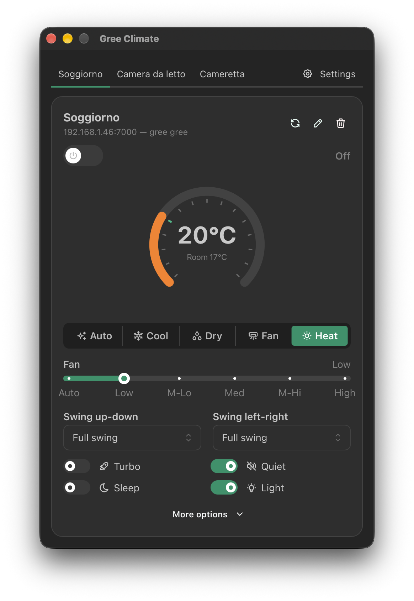

# Gree Climate

A menu-bar companion for GREE air conditioners (macOS, Tauri 2 + React).



## What it does

- Lives in the menu bar, out of the way.
- Finds your air conditioners on the local network.
- Turns them on and off, changes temperature, mode, fan speed, swings and extras (quiet, light, sleep, …).
- Remembers your devices and the names you give them.

## Run it

```bash
npm install
npm run tauri dev
```

## Distribute (macOS, unsigned)

```bash
npm run dist:mac
```

This builds the `.app` and `.dmg` via Tauri, applies an ad-hoc signature (`codesign -s -`, no paid Apple Developer certificate needed), and packs a distributable `.zip` with SHA-256 checksums into `dist-release/`. See [scripts/build-macos.sh](scripts/build-macos.sh) for the exact steps.

The app is not notarized, so Gatekeeper blocks it on first launch. Recipients clear the quarantine flag once, then right-click the app → Open:

```bash
xattr -c "/Applications/Gree Climate.app"
```

## Notes

Unofficial project, not affiliated with GREE Electric Appliances. Everything stays on your local network.

The device protocol lives in the [`gree-climate`](https://github.com/thesmokinator/gree-climate) Rust crate.

Available in English and Italiano (Settings → Language).

Released under the MIT License — see [LICENSE](LICENSE).
